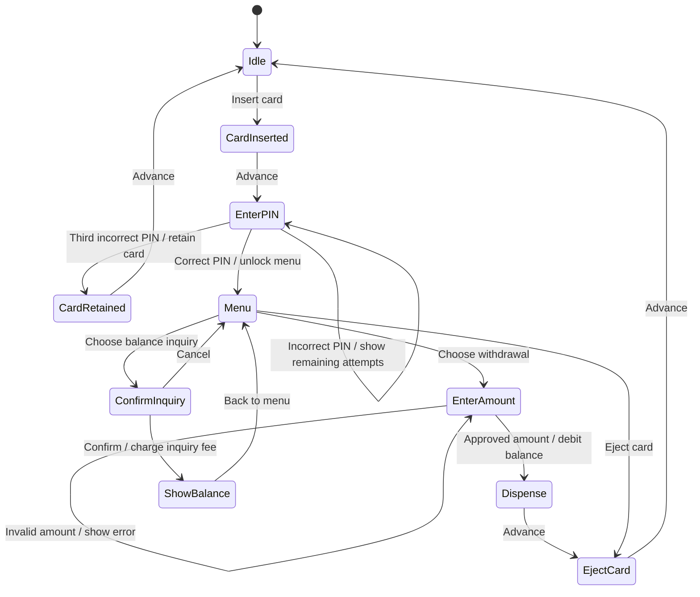

# ATM FSM Simulator

[](https://github.com/saadh472/atm-fsm-simulator/actions/workflows/quality.yml)

A browser-based ATM simulator that turns a Theory of Automata model into a working application. The Moore panel highlights the current state, while the Mealy panel shows which input triggered the last transition. A Flask API validates each action, and SQLite keeps account balances and transaction history between restarts.

## Quick start

Install **Python 3.10 or newer**. On Windows, double-click [Start ATM.cmd](Start%20ATM.cmd). It sets up the virtual environment, starts the server, and opens your browser. Keep the launcher window open while using the app.

On macOS or Linux, run these commands from the repository root.

```sh
python3 -m venv .venv
.venv/bin/python -m pip install -r requirements.txt
.venv/bin/python backend/app.py
```

Open [the simulator](http://127.0.0.1:8000/). To run the same commands manually on Windows, use `python` to create the environment and `.\.venv\Scripts\python.exe` as its interpreter. Set `ATM_PORT` to change the port or `ATM_DB_PATH` to select a different SQLite file.

## Try the demo

1. Choose a demo user and select **Insert Card**. Enter PIN **1234**.
2. Choose **Withdraw Cash** and submit `$100`. The cash-dispense state highlights and the starting balance falls from `$1,000` to `$900`.
3. After the card ejects, insert it again, enter the PIN, and choose **Balance Inquiry**. Cancel to keep the balance at `$900`. Open the inquiry again and confirm to deduct `$1` and see `$899`.
4. Restart the server or switch accounts to check that the original account keeps its own balance and history.

Withdrawals accept `$10` to `$500` in `$10` increments. Three incorrect PIN entries retain the simulated card and preserve the balance. **Reset demo account** restores the selected account to `$1,000` and clears its history and active card sessions.

## State flow



The [frontend](frontend/project.html) renders the account and state returned by the server. The [Flask backend](backend/app.py) enforces the state transitions and expires inactive card sessions after 15 minutes. SQLite creates `data/atm.sqlite3` on first launch and seeds five separate demo accounts. It stores money as integer cents and commits the debit, history entry, and state change together. The server rejects stale session revisions so a repeated request cannot repeat a debit.

## API

| Method and path | Behavior |
| --- | --- |
| `GET /api/health` | Check that the simulator is running. |
| `GET /api/accounts/{id}` | Read the balance and recent history for a demo account. |
| `POST /api/accounts/{id}/sessions` | Insert a card and start a session. |
| `POST /api/sessions/{token}/actions` | Apply an action using the current `revision` and any required PIN or amount. |
| `POST /api/accounts/{id}/reset` | Reset the selected demo account. |

Use demo account IDs `1` through `5`. Send JSON objects with POST requests. Withdrawal requests send `amount` as a decimal dollar string, such as `"100.00"`. Account responses return monetary values in cents.

If SQLite is busy, the API returns `503` with a `Retry-After` header. The browser also times out stalled requests and lets the user retry. The same revision is used on retry so a request that already completed cannot charge the account again.

## Verification

```sh
python -m unittest discover -s tests -v
node --check frontend/app.js
```

Run the Python command with the virtual environment interpreter. The integration suite uses a temporary database to verify persistence, PIN lockout, inquiry fees, duplicate submissions, simultaneous withdrawals, and retries after a database lock. GitHub Actions runs the suite on Linux and Windows.

The simulator is an educational project for localhost and fictional data. The shared demo PIN, sample accounts, and reset controls are part of the simulation.
